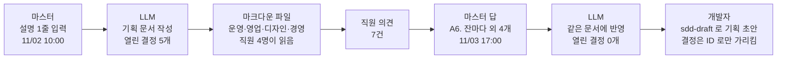

# sdd-brief 스킬 기획 초안

기준 날짜: 2026-11-02 · 기준 코드: `origin/main` 119734a

## 필요한 결정

### 열린 결정

없음

### 정해진 결정

- **D1. 이 스킬의 이름은 `sdd-brief` 다**
    - 답: @확정 (2026-11-02 "d1. a")
    - 반영한 곳: 문서 제목, 도메인 언어「`sdd-brief`」, 파일 이름 `.claude/specs/2026-11-02-sdd-brief.md`
- **D2. 기획 문서는 기능마다 폴더 하나를 두고, 요구사항 문서·design.md 와 같은 폴더에 `brief.md` 로 둔다**
    - 답: @확정 (2026-11-02 "d2. 같은 디렉터리에 두기", 파일 이름·폴더 해석은 2026-11-02 "둘 다 맞음")
    - 반영한 곳: 요구사항 4 인수 조건 5, 기존 시스템과 맞닿는 곳「별개 작업으로 나눌 것」
- **B1. 같은 기능의 결정 원본은 기획 문서다. `sdd-draft` 는 기획 문서를 받아 결정 ID 를 가리키고 개발 요소만 더한다**
    - 답: @확정 (2026-11-02 "B1 -> b안.")
    - 반영한 곳: 요구사항 1 범위 밖, 요구사항 5 인수 조건 2, 기존 시스템과 맞닿는 곳「구현 전에 확인할 위험」「별개 작업으로 나눌 것」
- **B2. 기본 형식은 마크다운 파일이다. 설명에 아티팩트로 만들라는 말이 있을 때만 공유 문서(artifact)로 쓴다**
    - 답: @확정 (2026-11-02 "B2 -> b안", 아티팩트 조건은 2026-11-02 "둘 다 맞음. 단 설명이 있을때만 아티팩트로 만들게 해줘.")
    - 반영한 곳: 요구사항 1 업무 규칙(그림 행), 요구사항 4 인수 조건 4, 핵심 흐름 그림, 기존 시스템과 맞닿는 곳「코드에서 확인한 사실」 여섯째 줄
- **A1. 지금 이야기와 바뀐 뒤 이야기를 둘 다 쓴다**
    - 답: @확정 (2026-11-02 "A1 -> b안.")
    - 반영한 곳: 도메인 언어「지금 이야기, 바뀐 뒤 이야기」, 요구사항 1 인수 조건 3, 요구사항 3, 요구사항 4 업무 규칙
- **A2. 결정 표기(`@결정`·`@초안`·`@미정` 등)를 기획 문서에 붙이지 않는다**
    - 답: @확정 (2026-11-02 "A2 -> c안.")
    - 반영한 곳: 도메인 언어「개발 요소」, 요구사항 1 업무 규칙, 요구사항 3 인수 조건 4, 요구사항 5 인수 조건 1·4, 기존 시스템과 맞닿는 곳「코드에서 확인한 사실」 넷째 줄
- **A3. 요구사항은 사용자 스토리, "~하면 ~된다" 확인 목록, 업무 규칙 표로 쓴다**
    - 답: @확정 (2026-11-02 "A3 -> a안.")
    - 반영한 곳: 요구사항 1 업무 규칙, 요구사항 4 업무 규칙
- **C1. 다 쓴 뒤 하위 에이전트가 비개발자 직원 역할로 읽고 모르는 말 목록을 돌려준다**
    - 답: @확정 (2026-11-02 "C1 -> b안.")
    - 반영한 곳: 요구사항 2 인수 조건 3, 요구사항 2 업무 규칙 머리말

## 도메인 언어

- `sdd-brief`
    - 이 초안이 만들려는 스킬 이름이다. 표기는 영어 소문자와 `-` 그대로 쓴다. @확정 (D1, 2026-11-02)
- `sdd-design`
    - 마스터 원문은 "design.md(요구사항 문서와 같은 디렉터리에 있는, "어떻게 만드는가" 를 적은 문서, 시스템 아키텍처, 컴포넌트 설계, 시퀀스 다이어그램, 데이터 흐름, 오류 처리, 테스트 전략)을 만드는데 쓸 스킬이름" 이다. 이 초안의 스킬이 아니다. @결정
- 기획 요소
    - 누가, 무엇을, 왜, 어떤 규칙으로 하는지, 언제 다 된 것으로 보는지처럼 사람과 일의 말로 설명할 수 있는 내용이다. @초안
    - 마스터는 이 말을 정의하지 않았다. 경계는 요구사항 1 의 업무 규칙에 둔다
- 개발 요소
    - 코드 경로, 테이블, API, `THE System SHALL` 같은 EARS 문장, 코드 근거 표기(`@사실 ({경로})`)처럼 개발자만 읽을 수 있는 내용이다. @초안
    - 결정 표기(`@결정`·`@초안` 등)도 개발 요소다. @확정 (A2, 2026-11-02)
- 다른 직원
    - 마스터 원문은 "다른 직원(비개발자 포함)들이 모두 이해할 수 있도록" 이다. 운영·영업·디자인·경영 담당처럼 코드를 읽지 않는 사람을 포함한다. @결정
- AS-IS
    - 마스터 원문은 "기존에 AS-IS를 친절한 플로우로 대체한다" 이다. 이 문서에서는 지금 이야기와 바뀐 뒤 이야기로 바꿔 쓰는 자리를 가리킨다. @확정 (A1, 2026-11-02)
    - 부딪히는 곳: `origin/main` 의 어느 스킬에도 AS-IS 라는 절이 없다 (「기존 시스템과 맞닿는 곳」 참고)
- 친절한 플로우, 유저시나리오
    - 마스터 원문은 "친절한 플로우(가능하면 아주 이해하기 쉬운 유저시나리오로 설명)" 이다. 두 말을 같은 뜻으로 본다. @해석
    - 이름 있는 인물 한 명이 한 장면에서 겪는 일을 시간 순서대로 쓴 짧은 이야기다. 금액·날짜·횟수는 실제 숫자로 쓴다. @초안
- 지금 이야기, 바뀐 뒤 이야기
    - LLM 이 붙인 이름이다. 지금 이야기는 기능이 생기기 전 인물이 겪는 일, 바뀐 뒤 이야기는 기능이 생긴 뒤 같은 인물이 겪는 일이다. @확정 (A1, 2026-11-02)
- 기획 문서
    - LLM 이 붙인 이름이다. `sdd-brief` 가 만드는 문서를 가리킨다. `sdd-draft` 가 만드는 문서는 기획 초안이라고 부른다. @초안

## sdd-brief 스킬이란

- 목적
    - 개발자가 아닌 직원도 처음부터 끝까지 읽고 결정에 의견을 낼 수 있는 기획 문서를 쓴다. @해석
- 참여자
    - 마스터: 만들려는 것을 한 덩어리 설명으로 주고, 열린 결정에 답한다
    - LLM: 설명을 기획 문서로 쓰고, 답을 같은 문서에 반영한다
    - 다른 직원: 문서를 읽고 이야기와 규칙이 실제 업무와 맞는지 의견을 낸다
    - 개발자: 기획이 정해진 뒤 `sdd-draft` 로 기획 초안을 따로 쓴다. 결정은 기획 문서의 결정 ID 로만 가리킨다 (B1)
- 정해진 원칙
    - 개발 요소를 제외하고 기획 요소만 담는다. @결정
    - 다른 직원(비개발자 포함)들이 모두 이해할 수 있도록 쓴다. @결정
    - 기존의 AS-IS 를 친절한 플로우, 가능하면 아주 이해하기 쉬운 유저시나리오로 대체한다. @결정
- 비슷한 기존 스킬과의 차이
    - `sdd-draft`: 결정·요구사항 모양은 같다. 다만 EARS 문장과 코드 근거(「기존 시스템과 맞닿는 곳」)를 담고, 독자가 마스터와 개발자다
    - `sdd-quick`: 같은 모양을 채팅 답으로 쓴다. 문서가 남지 않아 다른 직원에게 넘길 수 없다
    - `spec-build`: 이미 있는 PR·브랜치를 검토하는 문서다. 코드가 있어야 쓴다
    - `sdd-design` (아직 없음): 어떻게 만드는가를 적는 design.md 를 쓴다. 기획 문서에서 뺀 개발 요소 중 설계에 해당하는 것이 그쪽으로 간다

## 핵심 흐름

예시 1건: 마스터가 `/sdd-brief 제휴카페 — 제휴회사 직원이 제휴카페에서 사면 한 잔에 1,500원 할인, 깎아 준 돈은 회사가 다음 달 카페에 준다` 를 입력한다. 아래는 「정해진 결정」을 모두 따른 결과다.

### 결론: 직원 4명이 이틀 안에 결정 5개를 정하고, 개발자는 그 결정 ID 만 가리켜 기획 초안을 쓴다

그림은 왼쪽에서 오른쪽으로 읽는다. 상자 아래 줄의 숫자는 예시다.

### 문서 안에 실제로 들어가는 이야기

- 지금 이야기
    - 써큘러랩스 김민지 대리는 점심을 먹고 회사 1층 '빈카페'에서 아메리카노 한 잔을 산다. 값은 5,900원이다. 김 대리는 계산대에서 5,900원을 모두 낸다. 회사가 빈카페와 제휴를 맺었다는 소문은 들었지만, 무엇이 달라지는지는 모른다.
- 바뀐 뒤 이야기
    - 다음 날 김 대리는 같은 아메리카노를 고르고 계산대에서 사원증을 보여 준다. 점원이 화면에서 '제휴회사 직원' 버튼을 누르자 1,500원이 빠지고, 김 대리는 4,400원을 낸다. 빈카페는 이번 달 이렇게 깎아 준 돈을 모아 다음 달에 회사에서 받는다. 김 대리 동료가 라떼 두 잔을 한 번에 사면 몇 원이 빠지는지는 아직 정하지 않았다 (열린 결정으로 올라간다).

### 같은 규칙이 두 문서에서 어떻게 다르게 쓰이는가

- `sdd-draft` 기획 초안
    - `WHEN 제휴회사 직원이 제휴카페에서 결제하면, THE System SHALL 잔마다 1,500원을 할인한다. @초안 (A6)`
- `sdd-brief` 기획 문서
    - 제휴회사 직원이 제휴카페에서 사면, 한 잔에 1,500원씩 깎아 준다.
    - 문장 끝에 아무 표기도 없다 (A2). 이 규칙이 아직 제안인지는 「정해야 할 것」 절에서만 알 수 있다

## 요구사항

요구사항은 5개다. 요구사항 1~3 은 마스터 설명의 세 문장에서, 요구사항 4~5 는 그 세 문장을 스킬로 만들 때 드러난 빈 곳에서 나왔다.

### 요구사항 1: 기획 요소만 담기

**사용자 스토리:** 운영 담당 직원으로서, 코드 이야기 없이 기획 내용만 읽어서 내 업무와 맞는지 바로 판단하고 싶다.

**인수 조건**
1. THE System SHALL 기획 문서에 아래 업무 규칙의 "남길 것" 만 담는다. @해석
2. IF 설명이나 조사 결과에 "뺄 것" 이 섞여 있으면, THEN THE System SHALL 그 내용을 문서에 쓰지 않고 채팅 끝맺음에 "요구사항이면 기획 초안(`sdd-draft`), 설계면 design.md(`sdd-design`)로 넘길 것" 으로 한 줄씩 적는다. @초안
3. WHEN 기획 문서를 쓰기 전에 조사하면, THE System SHALL 코드는 지금 기능이 어떻게 돌아가는지 알아내는 데만 쓰고, 알아낸 것은 지금 이야기로 옮긴다. @확정 (A1, 2026-11-02)

**업무 규칙**
| 내용 | 기획 문서에 | 표기 |
|---|---|---|
| 필요한 결정(옵션, 예시, 추천안) | 남길 것 | @초안 |
| 용어 뜻 | 남길 것 | @초안 |
| 목적, 참여자, 정해진 원칙 | 남길 것 | @초안 |
| 지금 이야기, 바뀐 뒤 이야기 | 남길 것 | @확정 (A1, 2026-11-02) |
| 사용자 스토리, 업무 규칙, 범위 밖 | 남길 것 | @확정 (A3, 2026-11-02) |
| 결정 표기(`@결정`·`@초안`·`@미정` 등) | 뺄 것 | @확정 (A2, 2026-11-02) |
| EARS 문장(`THE System SHALL`) | 뺄 것 | @확정 (A3, 2026-11-02) |
| 코드 경로, 테이블, API, 코드 근거(`@사실 ({경로})`) | 뺄 것 | @초안 |
| 구현 위험, 별개 작업으로 나눌 개발 일 | 뺄 것 | @초안 |
| 흐름 그림(mermaid `flowchart LR`, 노드에 예시 숫자) | 남길 것. 마크다운 화면이 그림으로 보여 준다 | @초안 (B2 에서 새로 생긴 빈 곳) |

**범위 밖:** 기획 초안을 함께 만들어 주는 것 (B1)

### 요구사항 2: 모두가 이해하는 말

**사용자 스토리:** 영업 담당 직원으로서, 처음 보는 말 없이 문서를 끝까지 읽어서 고객에게 이 기능을 설명하고 싶다.

**인수 조건**
1. THE System SHALL 모든 문장을 일상에서 쓰는 말로 쓰고, 기술용어를 쓰지 않는다. @해석
2. IF 업무 용어(예: 정산, 사원증 인증)가 꼭 필요하면, THEN THE System SHALL 「쓰는 말」 절에 한 문장 뜻을 적고 본문에서는 그 이름만 쓴다. @초안
3. WHEN 문서를 다 쓰면, THE System SHALL C1 에서 정한 방법으로 쉬운 말 점검을 하고, 걸린 문장을 고친 뒤에 끝맺음을 보낸다. @확정 (C1, 2026-11-02)
4. THE System SHALL 금액·날짜·횟수를 "일정 금액", "정해진 기간" 같은 말 대신 실제 숫자로 쓴다. @초안

**업무 규칙** (쓸 때 참고하는 쉬운 말 바꾸기 예시. 다 쓴 뒤 점검은 C1 방법만 쓴다)
| 쓰지 않는 말 | 대신 쓰는 말 | 표기 |
|---|---|---|
| API 호출이 실패하면 | 화면에서 저장이 안 되면 | @초안 |
| 레코드를 생성한다 | 목록에 한 줄이 새로 생긴다 | @초안 |
| 배치로 정산한다 | 매달 1일에 한 번에 모아 계산한다 | @초안 |
| 권한이 없으면 | 이 화면을 볼 수 없는 직원이면 | @초안 |

**업무 규칙** (점검 횟수)
| 항목 | 기준 | 표기 |
|---|---|---|
| 다시 점검 | 고친 문장이 5개 이상이면 한 번 더 | @초안 (C1) |
| 최대 횟수 | 2회 | @초안 (C1) |

**범위 밖:** 영어 문서로 옮기기

### 요구사항 3: 지금 상태를 이야기로 쓰기

**사용자 스토리:** 경영 담당 직원으로서, 이 기능이 생기면 직원·고객의 하루가 어떻게 달라지는지 이야기로 읽어서 할지 말지를 판단하고 싶다.

**인수 조건**
1. THE System SHALL 기존 AS-IS 자리를 친절한 플로우, 가능하면 유저시나리오로 쓴다. @결정
2. THE System SHALL 유저시나리오마다 이름 있는 인물 한 명, 장소 한 곳, 실제 숫자 하나 이상을 넣는다. @초안
3. WHERE 기능이 지금 없는 새 기능이면, THE System SHALL 지금 이야기에 "지금은 이렇게 한다" 를 쓴다. @확정 (A1, 2026-11-02)
4. IF 지금 이야기를 쓸 사실을 확인하지 못했으면, THEN THE System SHALL 그 문장을 이야기에 쓰지 않고 「정해야 할 것」의 열린 결정으로 올린다. @초안 (A2 에서 새로 생긴 빈 곳)
5. WHEN 바뀐 뒤 이야기에 아직 정하지 않은 규칙이 나오면, THE System SHALL 이야기 안에서 짐작으로 채우지 않고 결정 ID 를 가리킨다. @초안

**업무 규칙** (이야기 길이)
| 항목 | 기준 | 표기 |
|---|---|---|
| 이야기 하나 | 3~6문장 | @초안 |
| 이야기 수 | 지금 1개 + 바뀐 뒤 1개가 기본. 인물 종류가 다르면(예: 고객, 점원) 인물마다 1쌍 | @확정 (A1, 2026-11-02) |
| 인물 이름 | 실제 직원 이름 대신 지어낸 이름 | @초안 |

**범위 밖:** 화면 그림(와이어프레임) 그리기. 필요하면 `pug-frame` 을 따로 쓴다

### 요구사항 4: 기획 문서의 절 구성

**사용자 스토리:** 디자인 담당 직원으로서, 어느 기획 문서든 같은 순서로 읽어서 내가 볼 부분을 바로 찾고 싶다.

**인수 조건**
1. THE System SHALL 아래 업무 규칙의 순서로 절을 쓴다. @초안
2. IF 해당 없는 절이 있으면, THEN THE System SHALL 절을 지우지 않고 "해당 없음 — {이유 한 줄}" 을 남긴다. @초안
3. THE System SHALL 같은 규칙·숫자·용어 뜻을 문서에 한 번만 쓰고, 다른 곳에서는 결정 ID·요구사항 번호·용어 이름으로 가리킨다. @초안
4. WHERE 설명에 "artifact"·"아티팩트" 로 만들라는 말이 있으면, THE System SHALL 마크다운 파일 대신 공유 문서로 쓴다. 그 말이 없으면 독자가 직원이어도 마크다운으로 쓴다. @확정 (B2, 2026-11-02)
5. WHEN 기획 문서를 마크다운으로 저장하면, THE System SHALL 그 기능의 요구사항 문서·design.md 와 같은 디렉터리에 `brief.md` 로 둔다 (예: `.claude/specs/partner-cafe/brief.md`). @확정 (D2, 2026-11-02)

**업무 규칙** (절 순서)
| 순서 | 절 이름 | 담는 것 | 표기 |
|---|---|---|---|
| 1 | 정해야 할 것 | 열린 결정, 정해진 결정 | @초안 |
| 2 | 쓰는 말 | 용어와 뜻 | @초안 |
| 3 | 무엇을, 왜 | 목적, 참여자, 정해진 원칙 | @초안 |
| 4 | 이야기 | 지금 이야기, 바뀐 뒤 이야기, 흐름 그림 | @확정 (A1, 2026-11-02) |
| 5 | 해야 할 일 | 사용자 스토리, 확인 목록, 업무 규칙, 범위 밖 | @확정 (A3, 2026-11-02) |

**범위 밖:** 회사 기존 기획서 양식에 맞추기 (마스터가 양식을 주면 그 양식이 우선한다)

### 요구사항 5: 답 반영과 기획 초안으로 넘기기

**사용자 스토리:** 마스터로서, "A1. b" 처럼 짧게 답해서 기획 문서를 고치고, 정해진 기획을 개발자에게 그대로 넘기고 싶다.

**인수 조건**
1. WHEN 마스터가 "A1. b" 처럼 답하면, THE System SHALL `sdd-draft` 포맷 문서의 「답 반영」대로 같은 기획 문서를 고친다. 다만 고친 자리에는 표기를 붙이지 않고, 답 원문은 「정해야 할 것」의 정해진 결정 자리에만 둔다. @확정 (A2, 2026-11-02)
2. WHEN 열린 결정이 0개가 되면, THE System SHALL 끝맺음에 기획 초안을 쓰는 다음 명령 한 줄을 적는다 (예: `/sdd-draft {기획 문서 경로}`). @확정 (B1, 2026-11-02)
3. IF 직원 의견이 정해진 결정과 다른 말을 하면, THEN THE System SHALL 결정을 고치지 않고 다음 번호의 열린 결정으로 올린다. @초안
4. WHEN 답을 반영할 고칠 자리를 찾을 때, THE System SHALL 본문 표기 대신 그 결정의 「걸린 곳」 목록을 쓴다. 그래서 열린 결정마다 「걸린 곳」을 빠짐없이 적는다. @초안 (A2 에서 새로 생긴 빈 곳)

**범위 밖:** 직원 의견에 직접 답하기, 직원에게 알림 보내기

## 기존 시스템과 맞닿는 곳

### 코드에서 확인한 사실

- `origin/main` 의 `configs/claude`·`claude-plugins` 에 `sdd-brief`·`sdd-story`·`sdd-prd` 라는 스킬이 없다. @사실 (`git grep -i "brief\|prd" origin/main -- configs/claude claude-plugins`)
    - 정한 이름 `sdd-brief` 는 기존 스킬과 부딪히지 않는다 (D1)

- 스킬은 리포의 `configs/claude/skills/{이름}/SKILL.md` 에 두면 `~/.claude/skills/` 로 복사된다. @사실 (`scripts/sync-claude.sh`)
    - 새 스킬 자리는 `configs/claude/skills/sdd-brief/SKILL.md` 다
- `sdd-quick` 은 자기 포맷을 따로 두지 않고 `~/.claude/skills/sdd-draft/references/spec-format.md` 를 읽는다. @사실 (`configs/claude/skills/sdd-quick/SKILL.md`)
    - `sdd-brief` 도 결정·답 반영 모양은 같은 문서를 가리킬 수 있다. 다만 마커와 EARS 는 요구사항 1 에 따라 바꿔 써야 한다
- 포맷 문서는 마커를 "스펙, PR 본문, 결정이 필요한 답변에는 붙이고(MUST), README·가이드·회의록 등에는 붙이지 않는다(MUST NOT)" 로 정한다. @사실 (`configs/claude/skills/sdd-draft/references/spec-format.md` 「마커」)
    - 기획 문서는 붙이지 않는 쪽이다 (A2)
- `origin/main` 의 스킬·플러그인 어디에도 "AS-IS" 절이 없다. 가장 가까운 것은 `sdd-draft` 의 「기존 시스템과 맞닿는 곳」(코드 근거로 지금 상태를 적는 절)이다. @사실 (`git grep -i "as-is" origin/main`)
    - 그래서 AS-IS 를 지금 이야기와 바뀐 뒤 이야기 두 개로 덮었다 (A1)
- 전역 규칙에 "기술용어 제외, 일상에서 사용하는 언어 사용" 과 "테이블·숫자 목록 사용금지" 가 이미 있다. @사실 (`configs/claude/CLAUDE.md` 「어투」, `configs/claude/rules/markdown.md`)
    - 요구사항 2 는 첫 규칙 위에 점검 방법만 더한다. 기본 형식이 마크다운이므로(B2) 표는 `sdd-draft` 처럼 업무 규칙과 확인 목록 자리에만 쓴다

### 구현 전에 확인할 위험

- 같은 기능의 결정이 기획 문서와 기획 초안 두 곳에 생기면, 한쪽만 고쳐져 어긋난다. B1 로 기획 문서가 원본이 되었지만, `sdd-draft` 를 고치기 전까지는 기획 초안에 결정이 다시 쓰일 수 있다
- 부르는 말이 겹친다. `sdd-draft` 의 트리거가 "기획 초안 써줘" 라서, `sdd-brief` 에 "기획 문서 써줘" 를 걸면 LLM 이 둘 중 무엇을 고를지 흔들린다. 트리거 문구는 "비개발자도 읽을", "직원 공유용" 처럼 독자를 넣어 나눈다
- 포맷 문서를 세 스킬이 함께 읽게 되면, 포맷 문서를 고칠 때 `sdd-brief` 결과도 바뀐다. 포맷 문서를 가리킬 범위를 결정·답 반영으로 좁혀야 한다

### 별개 작업으로 나눌 것

- `sdd-draft` 가 기획 문서를 설명으로 받아 결정 ID 를 그대로 가리키게 고치기 (B1)
- `sdd-draft` 의 description 트리거 문구 다듬기 (위 두 번째 위험)
- `sdd-design` 스킬 만들기 (design.md 작성)
- `sdd-draft` 의 저장 자리를 기능별 폴더로 바꾸기 (D2)
