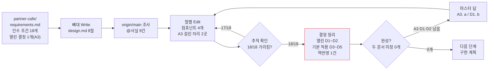

# sdd-design 기획 초안

기준 날짜: 2026-11-02 · 기준 코드: `origin/main` 588bef9

## 필요한 결정

### 열린 결정

없음

### 정해진 결정

- **A1. 기능마다 디렉터리 하나에 `requirements.md`·`design.md` 를 둔다**
    - 답: @확정 (2026-11-02 "a안")
    - 반영한 곳: 도메인 언어 「요구사항 문서」, 요구사항 1 인수 조건 2, 요구사항 2 인수 조건 1, 기존 시스템과 맞닿는 곳 「별개 작업」
- **A2. 완성은 두 문서 모두 미정 0개인 상태이고, 설계 문서 작성을 막는 조건이 아니다**
    - 답: @확정 (2026-11-02 "a안. `design.md`, `requirements.md` 내부에 미정이 0개여야함. 단 requirements.md에 아직 미정이 있다는 의미는 개발자가 design.md에서 설계를 확인하고, 트레이드오프를 비교하기 위한 것일 수 있다. 따라서, 이를 위해 design.md 를 만드는것을 막아서서는 안된다.")
    - @해석: "미정" 은 `@미정` 마커와 「열린 결정」을 모두 뜻한다. 완성은 다음 단계(구현 계획)로 넘어가는 조건이다. 요구사항 문서에 열린 결정이 있어도 설계 문서는 만든다
    - 반영한 곳: 도메인 언어 「완성」, sdd-design 이란 「정해진 원칙」, 핵심 흐름, 요구사항 1 인수 조건 3·5, 요구사항 1 업무 규칙
- **A3. 설계 고유 규칙은 `sdd-design/SKILL.md` 에 두고 `spec-format.md` 를 그대로 읽는다**
    - 답: @확정 (2026-11-02 "a안.")
    - 반영한 곳: 요구사항 2 업무 규칙
- **A4. 인수 조건 전부를 「요구사항 추적」에서 센다**
    - 답: @확정 (2026-11-02 "a안.")
    - 반영한 곳: 요구사항 3 인수 조건 3, 요구사항 5 인수 조건 2, 요구사항 7 인수 조건 1~2
- **A5. 요구사항 문서의 열린 결정에 걸린 설계는 추천안 기준으로 쓰고, 다른 옵션이면 바뀌는 자리를 차이 목록으로 붙인다**
    - 답: @확정 (2026-11-02 "a안.")
    - 반영한 곳: 요구사항 1 인수 조건 3, 요구사항 1 업무 규칙
- **B1. 아키텍처 `flowchart LR`, 시퀀스 `sequenceDiagram`, 테이블 변경 시 `erDiagram`**
    - 답: @확정 (2026-11-02 "a안.")
    - 반영한 곳: 요구사항 3 인수 조건 1, 요구사항 4 인수 조건 5
- **B2. 테스트 전략은 인수 조건마다 테스트 층만 고르고 행동은 번호로 가리킨다**
    - 답: @확정 (2026-11-02 "a안.")
    - 반영한 곳: 요구사항 6 인수 조건 1~2
- **B3. 사용자에게 보이는 새 동작은 요구사항 문서로 역반영한다**
    - 답: @확정 (2026-11-02 "a.")
    - 반영한 곳: 요구사항 5 인수 조건 3~4, 요구사항 5 업무 규칙
- **B4. 컴포넌트마다 대안을 제시하되, 되돌리기 어려운 선택만 열린 결정으로 강조하고 나머지는 추천안을 기본 적용한다**
    - 답: @확정 (2026-11-02 "b안으로 가되, 되돌리기 어려운 선택은 강조하고, 나머지도 제시는 하되, 기본적으로 추천안이 선택되어 있는 형태로, 개발자가 원할때 항목을 수정한다.")
    - @해석: 되돌리기 어려운 선택은 「열린 결정」에 강조 표시로 올린다. 되돌리기 쉬운 선택은 추천안을 설계 본문에 적용하고, ID 를 붙여 마스터가 짧은 답으로 바꿀 수 있게 한다. 모으는 자리는 B6 에서 정한다
    - 반영한 곳: 도메인 언어 「기본 적용 결정」, 요구사항 3 인수 조건 4~6, 요구사항 3 업무 규칙 「되돌리기 판정」
- **B5. 컴포넌트 설계·오류 처리·요구사항 추적 절은 표로 쓴다**
    - 답: @확정 (2026-11-02 "a안.")
    - 반영한 곳: 요구사항 2 인수 조건 6
- **B6. 결정은 그룹별로 한 목록에 두고, 결정이 필요한 항목은 볼드, 추천안을 이미 적용한 항목은 이탤릭으로 쓴다**
    - 답: @확정 (2026-11-02 "현재 문서처럼 필요한 결정에 대해 각 섹션별로 ABC유지하고, 결정이 필요한 항목은 볼드처리, 추천안이 이미 적용된건 이탤릭. 결정은 지금 문서처럼 화살표 옆에 작성. 추천안으로 결정했으면 '추천안' 이라고 남김.")
    - @해석: 따로 「기본 적용 결정」 절을 두지 않는다. 결정 제목 끝에 `->` 를 두고 마스터가 그 옆에 답을 적는다. 답이 "추천안" 이면 추천안을 확정한다. 이탤릭 항목은 답이 없어도 완성 판정에서 미정으로 세지 않는다
    - 반영한 곳: 도메인 언어 「기본 적용 결정」, 요구사항 1 업무 규칙, 요구사항 2 인수 조건 7, 요구사항 2 업무 규칙, 요구사항 3 인수 조건 5~6, 요구사항 3 업무 규칙 「되돌리기 판정」, 요구사항 7 인수 조건 4·6
- **C1. 마크다운 경로만 먼저 만든다**
    - 답: @확정 (2026-11-02 "a안.")
    - 반영한 곳: 요구사항 2 범위 밖
- **C2. 작은 작업용 채팅 답 버전을 둔다**
    - 답: @확정 (2026-11-02 "b안.")
    - 반영한 곳: 요구사항 8
- **C3. 스킬 이름은 `sdd-design`**
    - 답: @확정 (2026-11-02 "a안.")
    - 반영한 곳: 도메인 언어 `sdd-design`
- **C4. 작은 작업의 설계는 `sdd-quick` 답에 「설계」 절로 붙인다**
    - 답: @확정 (2026-11-02 "b안.")
    - 반영한 곳: 요구사항 8, 기존 시스템과 맞닿는 곳 「코드에서 확인한 사실」

## 도메인 언어

- 요구사항 문서 (`requirements.md`)
    - 뜻: `sdd-draft` 가 `.claude/specs/{slug}/requirements.md` 에 쓴 기획 초안. 필요한 결정, 도메인 언어, 요구사항(EARS 인수 조건)이 담긴 문서 @확정 (A1, 2026-11-02)
- 설계 문서 (`design.md`)
    - 뜻: 요구사항 문서와 같은 디렉터리에 있는, "어떻게 만드는가" 를 적은 문서 @결정
    - 담는 것: 시스템 아키텍처, 컴포넌트 설계, 시퀀스 다이어그램, 데이터 흐름, 오류 처리, 테스트 전략 @결정
- 완성
    - 뜻: 요구사항 문서와 설계 문서 모두 「열린 결정」이 "없음" 이고 `@미정` 이 0개인 상태. 다음 단계로 넘어가는 조건이며 설계 문서 작성 조건이 아니다 @확정 (A2, 2026-11-02)
- 컴포넌트
    - 뜻: 책임 하나와 바깥에 보이는 인터페이스 하나를 가진 코드 단위. 모듈, 서비스, 람다, 테이블 묶음이 해당한다 @초안
- 되돌리기 어려운 선택
    - 뜻: 바꾸려면 운영 데이터나 바깥 사용자까지 고쳐야 하는 선택. 스키마, 외부 연동, 공개 API 가 해당한다 @초안
- 기본 적용 결정
    - 뜻: 되돌리기 쉬운 설계 선택 가운데, 추천안을 설계 본문에 미리 적용해 두고 마스터가 원할 때 바꾸는 결정 @확정 (B4, 2026-11-02)
    - 표기: 「열린 결정」의 같은 그룹 안에 이탤릭 제목으로 둔다. 결정이 필요한 항목은 볼드 제목이다 @확정 (B6, 2026-11-02)
- 추적
    - 뜻: 설계의 각 요소(컴포넌트, 시퀀스, 오류, 테스트)가 어느 `요구사항 {n} 인수 조건 {m}` 을 위해 있는지 가리키는 표기 @확정 (A4, 2026-11-02)
- 역반영
    - 뜻: 설계 중에 드러난 "사용자에게 보이는 새 동작" 을 설계 문서가 아니라 요구사항 문서의 열린 결정으로 올리는 일 @확정 (B3, 2026-11-02)
- `sdd-design`
    - 뜻: 이 초안이 기획하는 스킬의 이름 @확정 (C3, 2026-11-02)

## sdd-design 이란

- 목적: 요구사항 문서를 받아, 구현자가 코드 위치와 순서를 고르기만 하면 되는 설계 문서를 쓴다
- 참여자
    - 마스터: 요구사항 문서와 설계 문서의 열린 결정에 답하고, 기본 적용 결정을 원할 때 바꾼다
    - LLM: 요구사항 문서와 `origin/main` 코드를 읽고 설계 문서를 쓴다. 코드는 바꾸지 않는다
    - 다음 단계(구현 계획 스킬 또는 `wt:plan`): 완성된 두 문서를 읽고 작업 순서를 짠다
- 정해진 원칙
    - 설계 문서는 시스템 아키텍처, 컴포넌트 설계, 시퀀스 다이어그램과 데이터 흐름, 오류 처리와 테스트 전략을 담는다 @결정
    - 요구사항 문서에 열린 결정이 남아 있어도 설계 문서를 만든다. 설계가 그 결정의 트레이드오프를 비교하는 자료가 되기 때문이다 @확정 (A2, 2026-11-02)
    - 마스터가 결정만 내리면 다음 단계로 넘어갈 수 있어야 한다 @해석 (`sdd-draft` 목적 문장을 설계 단계에 옮김)
- 비슷한 기존 스킬과 차이
    - `sdd-draft`: "무엇을" 정한다. `sdd-design` 은 "어떻게" 를 정하고, "무엇을" 은 요구사항 번호로 가리키기만 한다
    - `spec-build`: 이미 있는 PR·브랜치를 검토한다. `sdd-design` 은 코드가 없을 때 쓴다
    - `spec-bdd`: Gherkin 시나리오를 쓴다. `sdd-design` 의 테스트 전략은 시나리오를 다시 쓰지 않는다 (B2)

## 핵심 흐름

### 요구사항 결정이 1개 남아 있어도 설계 문서는 나오고, 두 문서의 결정이 0개가 되어야 완성이다

- 읽는 법: 제휴카페 요구사항 문서에 A3 이 열린 채로 시작해도 설계 문서는 끝까지 쓴다. A3 에 걸린 2곳은 추천안 기준으로 쓰고 "A3 이 b 이면" 차이 목록을 붙인다 (A5). 결정 정리에서 되돌리기 어려운 D1~D2 만 열린 결정이 되고, D3~D5 는 추천안이 적용된 채 남는다. 마스터가 A3·D1·D2 에 답해 두 문서의 미정이 0개가 되면 완성이다.
- 역반영 1건은 설계 중 드러난 "결제 대행사 응답이 10초를 넘으면 고객 화면에 무엇을 보이는가" 같은 질문이다. 이 질문은 요구사항 문서의 열린 결정으로 간다 (B3).

## 요구사항

요구사항은 8개다. 요구사항 1, 3~6 은 마스터 문장("requirements.md가 완성되면", 네 가지 설계 주제)과 A2 답에서, 요구사항 2, 7 은 `sdd-draft` 의 문서 규칙(뼈대 먼저, 한 번만 쓴다, 답 반영)을 설계 단계에 옮긴 것에서, 요구사항 8 은 C2 답에서 나왔다.

### 요구사항 1: 요구사항 문서 읽기와 완성 판정

**사용자 스토리:** 마스터로서, 요구사항 문서에 결정이 남아 있어도 설계를 먼저 보고 트레이드오프를 비교해서 결정하고 싶다.

**인수 조건**
1. WHEN 마스터가 `/sdd-design {경로}` 를 실행하면, THE System SHALL 그 경로의 요구사항 문서를 끝까지 읽는다. @초안
2. IF 경로가 없으면, THEN THE System SHALL `.claude/specs/*/requirements.md` 후보를 찾아 `AskUserQuestion` 한 번으로 고르게 한다. @확정 (A1, 2026-11-02)
3. IF 요구사항 문서의 「열린 결정」에 결정이 1개 이상 남아 있으면, THEN THE System SHALL 그 결정의 추천안 기준으로 설계를 쓰고, 다른 옵션이면 바뀌는 자리를 "{결정 ID} 가 {옵션} 이면" 차이 목록으로 붙인다. @확정 (A2·A5, 2026-11-02)
4. IF 요구사항 문서에 `(작성 중)` 이 남아 있으면, THEN THE System SHALL 설계 문서를 쓰지 않고 그 절 이름을 안내한다. @초안
5. WHEN 두 문서 모두 열린 결정 0개, `@미정` 0개가 되면, THE System SHALL 끝맺음 첫 줄에 "완성 — 다음 단계로 넘어갈 수 있습니다" 를 쓴다. @해석 (A2)

**업무 규칙** (완성 판정 경계)
| 문서 상태 | 설계 문서 | 완성 | 표기 |
|---|---|---|---|
| 두 문서 열린 결정 0개, `@미정` 0개 | 씀 | 완성 | @확정 (A2, 2026-11-02) |
| 요구사항 문서 열린 결정 1개(A3) | 씀. 본문은 A3 추천안 기준, "A3 이 b 이면" 차이 목록 2곳 | 미완성 | @확정 (A2·A5, 2026-11-02) |
| 요구사항 문서 `@미정` 업무 규칙 1행 | 씀. 걸린 설계는 "@미정 대기 (요구사항 {n})" 로 남긴다 | 미완성 | @초안 |
| 요구사항 문서 결정 0개, 설계 문서 열린 결정 1개(D1) | 씀 | 미완성 | @확정 (A2, 2026-11-02) |
| 두 문서에 볼드 결정 0개, 설계 문서에 이탤릭 결정 3개(D3~D5) | 씀 | 완성 | @해석 (B6) |

**범위 밖:** 요구사항 문서를 대신 고치거나 완성하는 일 (`sdd-draft` 의 「답 반영」이 한다)

### 요구사항 2: 설계 문서 위치와 절 구성

**사용자 스토리:** 마스터로서, 요구사항 문서 옆에서 설계 문서를 바로 찾고, 어느 기능의 설계든 같은 순서로 읽고 싶다.

**인수 조건**
1. THE System SHALL 설계 문서를 요구사항 문서와 같은 디렉터리에 `design.md` 로 둔다. @확정 (A1, 2026-11-02)
2. WHEN 설계를 시작하면, THE System SHALL 조사보다 먼저 제목, 기준 날짜, 입력 요구사항 문서 경로, 절 헤딩과 절마다 `(작성 중)` 한 줄로 뼈대를 만든다. @초안
3. WHEN 절 하나를 채울 때마다, THE System SHALL 채팅에 "지금 {절} 작성 중" 한 줄을 남긴다. @초안
4. IF 같은 경로에 설계 문서가 이미 있으면, THEN THE System SHALL 덮어쓰기 전에 읽고 갱신인지 새 파일인지 한 번 묻는다. @초안
5. THE System SHALL 해당 없는 절을 지우지 않고 "해당 없음 — {이유 한 줄}" 로 남긴다. @초안
6. THE System SHALL 컴포넌트 설계, 오류 처리, 요구사항 추적 절은 표로 쓰고, 나머지 절은 2단 불릿으로 쓴다. @확정 (B5, 2026-11-02)
7. THE System SHALL 결정 항목마다 제목 끝에 `->` 를 두어, 마스터가 그 옆에 답을 적을 자리를 만든다. @확정 (B6, 2026-11-02)

**업무 규칙** (설계 문서 절 순서)
| 순서 | 절 | 담는 것 | 표기 |
|---|---|---|---|
| 1 | 필요한 결정 | 열린 결정(그룹별, 결정 필요는 볼드·기본 적용은 이탤릭), 정해진 결정 | @확정 (B6, 2026-11-02) |
| 1 | 필요한 결정 | 그룹 문자는 D 부터 써서 요구사항 문서의 A~C 와 겹치지 않게 한다 | @초안 |
| 2 | 시스템 아키텍처 | 요구사항 3 | @결정 |
| 3 | 컴포넌트 설계 | 요구사항 3 | @결정 |
| 4 | 시퀀스 다이어그램 | 요구사항 4 | @결정 |
| 5 | 데이터 흐름 | 요구사항 4 | @결정 |
| 6 | 오류 처리 | 요구사항 5 | @결정 |
| 7 | 테스트 전략 | 요구사항 6 | @결정 |
| 8 | 요구사항 추적 | 요구사항 7 | @확정 (A4, 2026-11-02) |

**범위 밖:** 공유 문서(Claude Docs) 형식 (C1), 구현 작업 목록(`tasks.md`)

### 요구사항 3: 시스템 아키텍처와 컴포넌트 설계

**사용자 스토리:** 마스터로서, 새 기능이 기존 시스템 어디에 붙고 어떤 코드 단위로 나뉘는지 한 장으로 보고, 원하는 선택만 골라 바꾸고 싶다.

**인수 조건**
1. THE System SHALL 시스템 아키텍처를 mermaid `flowchart LR` 하나로 그리고, 새 컴포넌트와 기존 컴포넌트를 다른 클래스로 구분한다. @확정 (B1, 2026-11-02)
2. THE System SHALL 기존 컴포넌트마다 `@사실 ({origin/main 경로})` 를 붙인다. @초안
3. THE System SHALL 컴포넌트마다 책임 한 문장, 인터페이스(함수 시그니처·API 경로·이벤트 이름), 의존하는 컴포넌트, 추적 ID 를 쓴다. @확정 (A4, 2026-11-02)
4. THE System SHALL 컴포넌트마다 대안 1~2개와 트레이드오프를 함께 쓰고, 추천안을 설계 본문에 적용한다. @해석 (B4)
5. IF 선택이 되돌리기 어려우면, THEN THE System SHALL 그 선택을 「열린 결정」에 볼드 제목으로 올린다. @확정 (B6, 2026-11-02)
6. IF 선택이 되돌리기 쉬우면, THEN THE System SHALL 추천안을 설계 본문에 적용하고, 그 선택을 같은 그룹에 이탤릭 제목으로 둔다. @확정 (B6, 2026-11-02)

**업무 규칙** (컴포넌트 표기 예시)
| 컴포넌트 | 책임 | 인터페이스 | 추적 | 표기 |
|---|---|---|---|---|
| `PartnerDiscountCalculator` (새) | 주문 줄마다 제휴 할인액을 계산한다 | `calc(line: OrderLine): Won` | 요구사항 2 인수 조건 1~3 | @초안 |
| `SettlementJob` (기존) | 월 정산을 만든다 | 변경 없음 | 요구사항 4 인수 조건 2 | @사실 ({경로}) |

**업무 규칙** (되돌리기 판정)
| 선택 예시 | 판정 | 가는 곳 | 표기 |
|---|---|---|---|
| 주문 테이블에 `partner_discount` 컬럼 추가 | 어려움 — 운영 데이터가 쌓인다 | 볼드 결정 | @초안 |
| 결제 대행사 선택 | 어려움 — 외부 계약이 걸린다 | 볼드 결정 | @초안 |
| 할인 계산을 서비스 함수로 둘지 클래스로 둘지 | 쉬움 — 코드만 바뀐다 | 이탤릭 결정 | @초안 |
| 제휴 목록을 캐시할지 | 쉬움 — 설정으로 끈다 | 이탤릭 결정 | @초안 |

**범위 밖:** 배포 인프라 설계(서버 대수, 비용 추정)

### 요구사항 4: 시퀀스 다이어그램과 데이터 흐름

**사용자 스토리:** 마스터로서, 구체 예시 1건이 어느 컴포넌트를 어떤 순서로 지나고 데이터가 어디에 저장되는지 보고 싶다.

**인수 조건**
1. THE System SHALL 요구사항 문서의 「핵심 흐름」 예시를 그대로 시나리오로 써서 mermaid `sequenceDiagram` 을 그린다. @초안
2. THE System SHALL 시퀀스 다이어그램 하나에 성공 경로 하나만 그리고, 실패 경로는 「오류 처리」에서 오류 ID 로 가리킨다. @초안
3. THE System SHALL 시퀀스 다이어그램 메시지 라벨에 예시 숫자를 넣는다 (예: `calc(5,900원) → 1,500원`). @초안
4. THE System SHALL 데이터 흐름에 데이터마다 생성 위치, 저장소(테이블·큐·캐시), 읽는 컴포넌트, 보존 기간을 쓴다. @초안
5. WHERE 테이블이나 컬럼이 바뀌면, THE System SHALL mermaid `erDiagram` 으로 바뀌는 테이블만 그리고 컬럼 타입과 소수점 자릿수를 적는다. @확정 (B1, 2026-11-02)

**업무 규칙** (그림 개수 상한)
| 항목 | 상한 | 넘으면 | 표기 |
|---|---|---|---|
| 시퀀스 다이어그램 | 요구사항 개수 이하 | 요구사항 2개를 한 그림으로 묶는다 | @초안 |
| 다이어그램 하나의 참여자 | 6개 | 컴포넌트를 묶어 상자 하나로 그린다 | @초안 |

**범위 밖:** 성능 수치 측정(부하 테스트)

### 요구사항 5: 오류 처리

**사용자 스토리:** 마스터로서, 실패가 일어나는 자리마다 누가 알아채고 사용자는 무엇을 보며 어떻게 되돌리는지 미리 알고 싶다.

**인수 조건**
1. THE System SHALL 오류마다 ID(`E1`), 발생 자리(컴포넌트), 감지 방법, 사용자에게 보이는 것, 복구(재시도·되돌림·수기 처리), 실패 방향(덜 줌·두 번 줌·조용함·시끄러움)을 쓴다. @초안
2. THE System SHALL 요구사항 문서의 `IF …, THEN` 인수 조건마다 오류 항목 하나 이상을 둔다. @확정 (A4, 2026-11-02)
3. IF 요구사항 문서에 없는 오류가 사용자에게 보이는 동작을 바꾸면, THEN THE System SHALL 설계 문서에 규칙을 새로 쓰지 않고 요구사항 문서의 열린 결정으로 올릴 문장을 제안한다. @확정 (B3, 2026-11-02)
4. IF 오류가 사용자에게 보이지 않으면(내부 재시도, 로그), THEN THE System SHALL 설계 문서 안에서만 정하고 `@초안` 을 단다. @확정 (B3, 2026-11-02)
5. WHERE 돈·정산이 걸린 오류이면, THE System SHALL 멱등 키와 중복 지급을 막는 장치를 적는다. @초안

**업무 규칙** (설계 문서에 쓸지, 역반영할지)
| 오류 예시 | 사용자에게 보임 | 쓰는 곳 | 표기 |
|---|---|---|---|
| 결제 대행사 응답 10초 초과 → 고객 화면 문구 | 보임 | 요구사항 문서 열린 결정 | @확정 (B3, 2026-11-02) |
| 정산 배치 DB 잠금 → 3회 재시도 | 안 보임 | 설계 문서 「오류 처리」 | @확정 (B3, 2026-11-02) |

**범위 밖:** 알람 채널·당번 체계 같은 운영 절차

### 요구사항 6: 테스트 전략

**사용자 스토리:** 마스터로서, 인수 조건마다 어느 층의 테스트가 지키는지 알고, 테스트가 없는 자리를 미리 알고 싶다.

**인수 조건**
1. THE System SHALL 인수 조건마다 검증하는 테스트 층(단위·통합·E2E·운영 확인)을 하나 고른다. @확정 (B2, 2026-11-02)
2. THE System SHALL 인수 조건의 행동을 Gherkin 이나 테스트 문장으로 다시 쓰지 않고 `요구사항 {n} 인수 조건 {m}` 으로 가리킨다. @확정 (B2, 2026-11-02)
3. THE System SHALL 테스트 더블(가짜 결제 대행사, 고정 시계)을 쓰는 경계를 컴포넌트 이름으로 적는다. @초안
4. THE System SHALL 업무 규칙 표의 경계 행(예: 1,500원 할인됨, 1,501원 거부)을 경계 테스트 대상으로 가리킨다. @초안
5. IF 자동 테스트로 지킬 수 없는 인수 조건이 있으면, THEN THE System SHALL 그 이유와 운영 확인 방법(쿼리·명령, 통과 기준)을 쓴다. @초안

**업무 규칙** (층 고르는 기준)
| 인수 조건 모양 | 기본 층 | 표기 |
|---|---|---|
| 계산식·값 대응(업무 규칙 표) | 단위 | @초안 |
| 컴포넌트 2개 이상 + 저장소 | 통합 | @초안 |
| 사용자 화면에서 끝나는 흐름 | E2E | @초안 |
| 외부 계약·운영 데이터에 기대는 것 | 운영 확인 | @초안 |

**범위 밖:** 테스트 코드 작성, Gherkin `.feature` 파일 작성(`spec-bdd`)

### 요구사항 7: 요구사항 추적과 결정 반영

**사용자 스토리:** 마스터로서, 요구사항 하나가 설계에서 빠지지 않았는지 세어서 확인하고, 설계 결정에 "D1. a" 로 답하고 싶다.

**인수 조건**
1. THE System SHALL 「요구사항 추적」 절에 인수 조건마다 그것을 가리키는 설계 요소(컴포넌트, 시퀀스, 오류 ID, 테스트 층)를 쓴다. @확정 (A4, 2026-11-02)
2. IF 어떤 설계 요소도 가리키지 않는 인수 조건이 있으면, THEN THE System SHALL 끝맺음 전에 그 절로 돌아가 채우거나 "설계 없음 — {이유}" 를 쓴다. @확정 (A4, 2026-11-02)
3. THE System SHALL 요구사항 문서의 규칙·수치·용어를 설계 문서에 다시 쓰지 않고 번호와 용어 이름으로 가리킨다. @결정 (포맷 문서 「한 번만 쓴다」)
4. WHEN 마스터가 채팅에 "D1. a" 로 답하거나 결정 제목의 `->` 옆에 답을 적으면, THE System SHALL 포맷 문서의 「답 반영」대로 같은 설계 문서를 고친다. @확정 (B6, 2026-11-02)
5. WHEN 요구사항 문서가 바뀌면(정해진 결정 추가, 요구사항 추가), THE System SHALL 「요구사항 추적」에서 바뀐 번호를 찾아 걸린 설계 요소만 고친다. @초안
6. IF `->` 옆 답이 "추천안" 이면, THEN THE System SHALL 그 결정의 추천안을 `@확정` 으로 옮긴다. @확정 (B6, 2026-11-02)
7. IF `->` 옆이 비어 있으면, THEN THE System SHALL 그 결정을 「열린 결정」에 그대로 두고 끝맺음 첫 줄에서 다시 묻는다. @초안

**범위 밖:** 요구사항 문서와 설계 문서의 어긋남을 자동으로 잡는 검사 스크립트 (별개 작업)

### 요구사항 8: 작은 작업용 채팅 답 버전

**사용자 스토리:** 마스터로서, 요구사항 1~2개짜리 작은 작업은 설계 문서 파일 없이 `sdd-quick` 답 하나로 요구사항과 설계를 함께 받고 싶다.

**인수 조건**
1. THE System SHALL 작은 작업의 설계를 파일 없이 채팅 답으로 쓴다. @확정 (C2, 2026-11-02)
2. THE System SHALL `sdd-quick` 답의 「요구사항」 절 뒤에 「설계」 절을 붙인다. @확정 (C4, 2026-11-02)
3. IF 작업이 규모 기준을 넘으면, THEN THE System SHALL 「설계」 절을 쓰지 않고 `/sdd-draft` 로 요구사항 문서를 만든 뒤 `/sdd-design` 을 쓰도록 한 줄로 권한다. @초안 (`sdd-design` 은 요구사항 문서가 있어야 쓸 수 있다)
4. THE System SHALL 「설계」 절 안에서 해당 없는 항목(아키텍처, 컴포넌트, 시퀀스, 오류, 테스트)은 "해당 없음" 줄 없이 뺀다. @초안 (`sdd-quick` 규칙을 옮김)

**업무 규칙** (「설계」 절 규모 기준)
| 항목 | `sdd-quick` 「설계」 절 | 문서(`sdd-design`) | 표기 |
|---|---|---|---|
| 컴포넌트 수 | 3개 이하 | 4개 이상 | @초안 |
| 스키마 변경 | 0건 | 1건 이상 | @초안 |
| 되돌리기 어려운 선택 | 0건 | 1건 이상 | @초안 |

**범위 밖:** 채팅 답으로 쓴 설계를 나중에 `design.md` 로 옮기는 변환

## 기존 시스템과 맞닿는 곳

### 코드에서 확인한 사실

- `sdd-draft` 는 요구사항 문서를 `.claude/specs/{YYYY-MM-DD}-{slug}.md` 에 쓰고 제목을 `{기능} 기획 초안` 으로 단다 @사실 (`origin/main:configs/claude/skills/sdd-draft/SKILL.md` 「저장 경로 정하기」)
    - 뜻: A1 확정에 맞추려면 `sdd-draft` 저장 경로를 `.claude/specs/{slug}/requirements.md` 로 바꿔야 한다
- 결정·요구사항·마커·답 반영의 모양은 `sdd-draft/references/spec-format.md` 한 곳에 있고 `sdd-quick` 도 그 문서를 읽는다 @사실 (`origin/main:configs/claude/skills/sdd-quick/SKILL.md`)
    - 뜻: `sdd-design` 도 그 문서를 읽는다 (A3). 단 볼드·이탤릭 구분과 `->` 옆 답 표기는 포맷 문서에 없어서 `sdd-design/SKILL.md` 에 정의해야 한다 (B6)
    - 뜻: C4 확정으로 `sdd-quick/SKILL.md` 「답의 모양」에 「설계」 절이 추가된다. `sdd-quick` 의 규모 확인 기준(요구사항 3개 이상이면 `sdd-draft` 로)과 요구사항 8 업무 규칙이 함께 읽혀야 한다
- `spec-build` 계약서에 플로우차트, 테스트 시나리오(Gherkin 셋으로 나눔), 오류의 실패 방향, 롤백 절이 이미 있다 @사실 (`origin/main:configs/claude/skills/spec-build/references/spec-contract.md`)
    - 뜻: 「오류 처리」의 실패 방향 네 가지와 「테스트 전략」의 운영 확인 층은 이 계약서 표현을 그대로 빌렸다
- 마크다운 규칙은 표와 숫자 목록을 금지한다 @사실 (`~/.claude/rules/markdown.md`)
    - 뜻: B5 확정으로 설계 문서 세 절이 예외가 된다. 예외 근거는 `sdd-design/SKILL.md` 에 적어야 다음 세션이 규칙 충돌로 보지 않는다

### 구현 전에 확인할 위험

- 이미 `.claude/specs/` 에 날짜 붙은 파일로 쓴 기획 초안이 있는지 확인하지 않았다. 있으면 A1 경로로 옮기는 방법이 필요하다

### 별개 작업으로 나눌 것

- `sdd-draft` 저장 경로를 `.claude/specs/{slug}/requirements.md` 로 바꾸는 일 (A1 의 후속)
- 구현 작업 목록(`tasks.md`)을 쓰는 다음 단계 스킬
- 요구사항 문서와 설계 문서의 번호 어긋남을 잡는 검사 스크립트
- `sdd-design` 의 공유 문서(Claude Docs) 경로 (C1)
