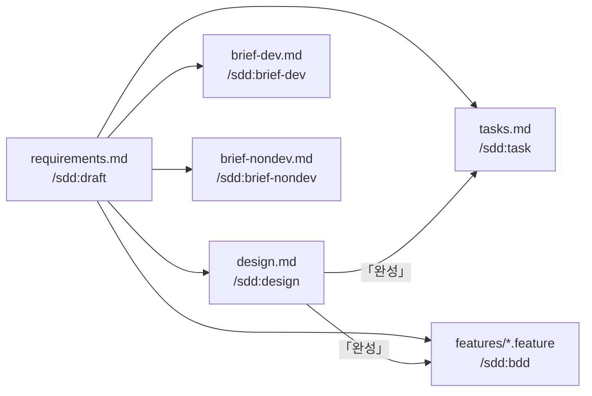

# sdd 결과물

sdd 명령이 남기는 결과물과, 결과물끼리 무엇을 읽는지 정리한 문서다. 명령을 고르는 순서는 [WORKFLOW.md](WORKFLOW.md) 에 있다.

## 어디에 남는가

`/sdd:quick` 을 뺀 모든 결과물은 요청 하나당 보관 폴더 하나에 모인다. 경로를 정하는 규칙은 `references/spec-format.md` 「저장 위치」 한 곳에 있다.

```text
~/.sdd/{리포 폴더}/{YYYYmmddHHMMSS}_{요청내용}/
  requirements.md
  design.md
  tasks.md
  brief-dev.md
  brief-nondev.md
  features/{도메인}/<actor>-<flow>.feature
```

`/sdd:quick` 은 채팅 답이라 파일을 남기지 않는다.

## 의존관계



화살표는 "뒤 문서가 앞 문서를 읽는다" 는 뜻이다. 「완성」 이 붙은 화살표는 앞 문서가 `references/design.md` 「완성」 조건을 채워야 뒤 문서를 쓸 수 있다는 뜻이다.

## 앞 문서가 없을 때

그림에 없는 동작만 적는다.

- requirements.md: 앞 문서가 없다. 모든 흐름의 시작점이다
- design.md: requirements.md 가 없으면 쓰지 않고 `/sdd:draft` 를 안내한다. requirements.md 에 열린 결정이 남아 있어도 쓴다
- tasks.md, features/: 둘 중 하나라도 없으면 쓰지 않고 빠진 문서를 만드는 명령을 안내한다. design.md 가 「완성」 이 아니면 남은 결정을 알려 준다
- brief-dev.md, brief-nondev.md: requirements.md 가 없으면 쓰지 않고 `/sdd:draft` 를 안내한다

## 앞 문서가 바뀌었을 때

화살표를 따라 뒤 문서를 다시 부른다.

- requirements.md 를 고쳤다 → `/sdd:design` 으로 설계에 반영한 뒤, 아래 design.md 줄을 따른다. brief 를 썼다면 `/sdd:brief-dev`·`/sdd:brief-nondev` 도 다시 부른다
- design.md 를 고쳤다 → `/sdd:task`, `/sdd:bdd` 를 다시 부른다
    - tasks.md 는 이미 끝난(`done`) 작업을 그대로 두고 고친다
- tasks.md, features/, brief 문서는 다른 문서가 읽지 않는다. 고쳐도 다시 부를 명령이 없다
