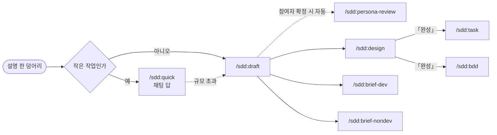

# sdd 작업 흐름

어떤 명령을 어떤 순서로 쓰는지 정리한 문서다. 각 결과물이 무엇을 읽고 어디에 남는지는 [OUTPUT.md](OUTPUT.md) 에 있다. 명령마다의 세부 규칙은 각 `skills/{이름}/SKILL.md` 에 있다.

## 첫 갈림길

- 작은 작업 → `/sdd:quick {설명}`
    - 스펙과 작은 설계를 채팅 답 하나로 받는다. 파일을 만들지 않는다
    - "작은 작업" 의 기준은 `skills/quick/SKILL.md` 「규모 확인」에 있다. 기준을 넘으면 quick 이 `/sdd:draft` 를 권한다
- 그 밖의 작업 → 아래 「기본 흐름」

화살표는 "앞 명령이 끝나야 뒤 명령을 쓸 수 있다" 는 뜻이다. `task` 와 `bdd` 는 같은 설계를 받아 나란히 쓸 수 있다.

## 기본 흐름

- `/sdd:draft {설명}`: 무엇을 만드는지 요구사항 문서로 쓴다. 이 흐름의 시작점이고, 요청 하나에 보관 폴더 하나를 만든다
    - 설명에 참여자를 나열하면 draft 가 문서를 다 쓴 뒤 `sdd:persona-review` 를 불러 참여자별로 빠진 과정을 채운다. 나열하지 않으면 참여자 목록 결정에 답한 뒤 부른다
- `/sdd:design {폴더}`: 어떻게 만드는지 설계 문서로 쓴다. 요구사항 문서에 열린 결정이 남아 있어도 쓸 수 있다
- 설계 문서가 「완성」 이 될 때까지 결정에 답한다 (아래 「결정에 답하기」)
- `/sdd:task {폴더}`: 어떤 순서로 만드는지 작업 DAG 로 쓴다
- `/sdd:bdd {폴더}`: 설계 문서가 E2E·통합으로 정한 인수 조건을 Gherkin 시나리오로 쓴다
- 구현은 마스터가 요청할 때 tasks.md 를 보고 시작한다

## 곁가지

- 다른 사람과 기획을 나눌 때: 요구사항 문서가 생긴 뒤 언제든
    - 개발자에게 → `/sdd:brief-dev {폴더}`
    - 운영·영업·디자인·경영 직원에게 → `/sdd:brief-nondev {폴더}`
- 공유 문서로 만들 때: 설명에 "artifact" 또는 "아티팩트" 를 넣는다. draft·brief 가 로컬 마크다운 대신 공유 문서로 쓴다
- 이미 있는 요구사항 문서를 참여자별로 다시 검토할 때: `/sdd:persona-review {폴더}`. 「참여자별 검토 기록」에 없는 참여자만 검토한다
- `/sdd:setup`: 보관 폴더(`~/.sdd/{리포 이름}/`)만 미리 만든다. draft 가 없으면 만들기 때문에 따로 부르지 않아도 된다

## 결정에 답하기

모든 단계에서 같은 방식으로 답한다.

- 문서나 채팅 답의 「필요한 결정」 에서 ID 와 옵션을 고른다. 예: `A1. a`, `D2. b`
- 답하면 LLM 이 같은 문서를 고친다. 새 문서를 만들지 않는다
- 앞 단계 문서의 결정이 바뀌면 뒤 단계 문서를 다시 부른다. 무엇을 다시 불러야 하는지는 [OUTPUT.md](OUTPUT.md) 「앞 문서가 바뀌었을 때」 에 있다

결정 ID, 마커, 답을 반영하는 모양은 `references/spec-format.md` 에 있다.
