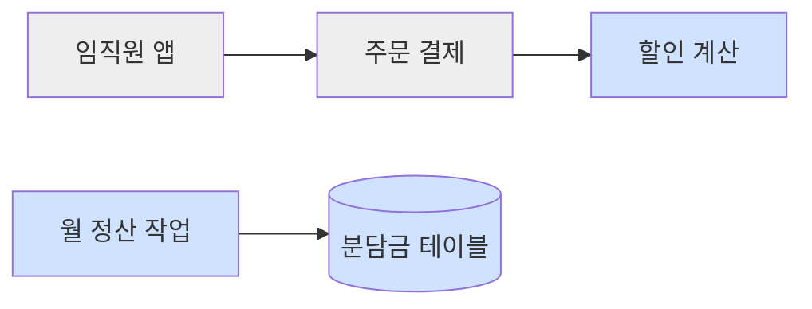
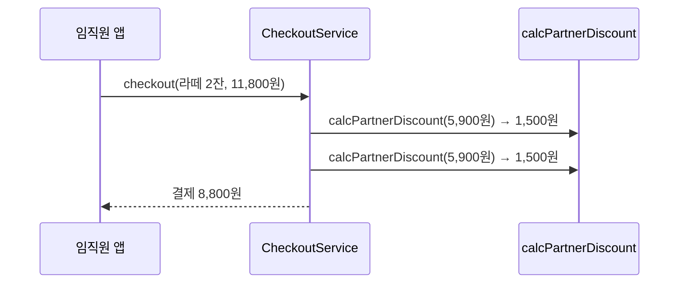
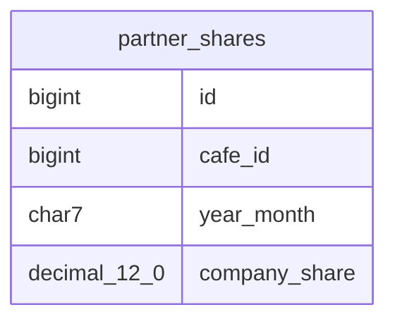

# 제휴카페 임직원 할인 설계

- 기준 날짜: 2026-11-02
- 기준 코드: origin/main 0000000
- 입력: `out/requirements.md`

## 필요한 결정

### 열린 결정

#### S 계산

- *S1. 할인 계산을 서비스 함수로 둔다* ->
    - 적용한 안: a. 서비스 함수 — 상태가 없어 테스트가 쉽다
    - 대안: b. 클래스 — 상태가 필요해지면 바꾼다
    - 걸린 곳: 컴포넌트 설계 `calcPartnerDiscount`

### 정해진 결정

- S2. 분담금을 별도 테이블에 저장한다 — 답: @확정 (2026-11-02 "b") — 반영한 곳: 데이터 흐름, 컴포넌트 설계 `SettlementJob`

## 시스템 아키텍처

새 할인 계산은 기존 주문 결제 안에 붙고, 새 정산 작업은 매달 따로 돈다.

파란 상자가 새로 만드는 것, 회색 상자가 기존 것이다.

## 컴포넌트 설계

| 컴포넌트 | 책임 | 인터페이스 | 의존 | 추적 | 표기 |
|---|---|---|---|---|---|
| `calcPartnerDiscount` (새) | 한 잔의 할인액을 계산한다 | `calcPartnerDiscount(price: Won): Won` | — | 요구사항 1 인수 조건 1, 3 | @초안 (S1) |
| `CheckoutService` (기존) | 결제 금액을 계산한다 | `checkout(order: Order): Payment` | `calcPartnerDiscount` | 요구사항 1 인수 조건 1, 2 | @사실 (`src/order/checkout.ts`) |
| `SettlementJob` (새) | 지난달 분담금을 카페별로 계산한다 | `run(month: YearMonth): void` | `partner_shares` | 요구사항 2 인수 조건 1, 2 | @확정 (S2, 2026-11-02) |

## 시퀀스 다이어그램

라떼 2잔 주문은 할인 계산을 두 번 불러 8,800원을 받는다.

위에서 아래로 읽는다. 잔마다 한 번씩 계산한다.

## 데이터 흐름

- 분담금
    - 생성 위치: `SettlementJob`
    - 저장소: `partner_shares` 테이블
    - 읽는 컴포넌트: 정산 화면
    - 보존 기간: 5년

## 오류 처리

| ID | 발생 자리 | 감지 | 사용자에게 보이는 것 | 복구 | 실패 방향 | 추적 | 표기 |
|---|---|---|---|---|---|---|---|
| E1 | `CheckoutService` 인증 확인 | 인증 플래그 없음 | 인증 안내 | 정가 결제 | 덜 줌 | 요구사항 1 인수 조건 2 | @초안 |
| E2 | `SettlementJob` 계산 | 예외 발생 | 없음 | 운영자 알림, 멱등 키 `cafe_id + year_month` 로 다시 실행 | 시끄러움 | 요구사항 2 인수 조건 2 | @초안 |

## 안전망

- 즉시 되돌림
    - 장치: 제휴 할인 기능 스위치. 끄면 정가 결제로 돌아간다 @초안
    - 걸린 컴포넌트: `CheckoutService`
    - 쓰는 때: 할인액이 틀리게 계산될 때

## 테스트 전략

- 층 고르는 기준
    - 단위: 요구사항 1 업무 규칙 표의 경계 행 (1,500원, 1,501원)
    - 통합: `SettlementJob` 과 `partner_shares`
    - E2E: 임직원 앱 결제 화면
- 테스트 더블: `SettlementJob` 에 고정 시계를 쓴다

## 요구사항 추적

인수 조건 5개 중 5개를 가리킨다 (2026-11-02).

| 인수 조건 | 컴포넌트 | 시퀀스 | 오류 | 테스트 층 |
|---|---|---|---|---|
| 요구사항 1 인수 조건 1 | `CheckoutService` | 주문 시퀀스 | — | E2E |
| 요구사항 1 인수 조건 2 | `CheckoutService` | — | E1 | E2E |
| 요구사항 1 인수 조건 3 | `calcPartnerDiscount` | 주문 시퀀스 | — | 단위 |
| 요구사항 2 인수 조건 1 | `SettlementJob` | — | — | 통합 |
| 요구사항 2 인수 조건 2 | `SettlementJob` | — | E2 | 통합 |
