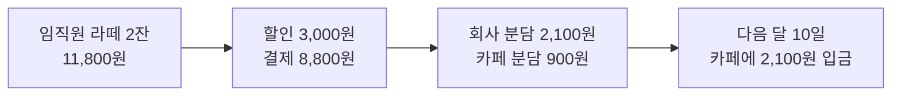

# 제휴카페 임직원 할인 기획 초안

2026-11-02 · @마스터

## 필요한 결정

없음

## 도메인 언어

| 용어 | 뜻 | 예시 | 표기 |
| --- | --- | --- | --- |
| 제휴 카페 | 회사와 할인 계약을 맺은 카페 | 판교역점 카페 | @결정 |
| 임직원 | 제휴 회사에 다니는 직원. 회사 이메일 인증을 마친 사람 | 김민지 (minji@acme.co.kr) | @결정 |
| 할인 한도 | 한 잔에 깎아 주는 최대 금액 | 1,500원 | @결정 |
| 할인 분담 | 할인액을 회사와 카페가 나눠 내는 비율 | 회사 70%, 카페 30% | @확정 (A2, 2026-11-02) |

- "임직원 인증"은 마스터 문장의 "회사 사람 확인"을 LLM 이 바꿔 부른 이름이다. 화면 문구와 맞추려는 이유다 @해석

## 제휴카페 임직원 할인이란

제휴 카페에서 임직원이 음료를 사면 한 잔마다 할인 한도까지 깎아 준다. @결정

**참여자**

| 누구 | 하는 일 | 돈·데이터 |
| --- | --- | --- |
| 임직원 | 앱으로 주문하고 결제한다 | 할인된 금액을 낸다 |
| 제휴 카페 | 주문을 받아 음료를 만든다 | 매달 회사에서 할인 분담금을 받는다 |
| 회사 | 할인 비용 일부를 낸다 | 매달 카페에 분담금을 보낸다 |

**정해진 원칙**

- 할인은 한 잔마다 1,500원까지다. @결정
- 회사 이메일 인증을 마친 임직원만 할인받는다. @결정

## 핵심 흐름

임직원이 5,900원 라떼 2잔을 주문하면 3,000원이 할인되어 8,800원을 내고, 카페는 다음 달 10일에 회사에서 2,100원을 받는다.

왼쪽에서 오른쪽으로 읽는다. 마지막 상자가 카페가 받는 돈이다.

## 요구사항

요구사항은 2개다. 요구사항 1은 마스터 문장, 요구사항 2는 A2 답에서 나왔다. 인수 조건 끝의 표기는 근거, 괄호 안 ID 는 걸린 결정이다.

### 요구사항 1: 주문 할인

**사용자 스토리:** 임직원으로서, 제휴 카페에서 음료를 할인받아 사서 점심값을 아끼고 싶다.

**인수 조건**
1. WHEN 인증된 임직원이 제휴 카페에서 결제하면, THE System SHALL 잔마다 할인 한도까지 할인한다. @결정
2. IF 임직원 인증이 끝나지 않았으면, THEN THE System SHALL 정가로 결제하고 인증 안내를 표시한다. @초안
3. THE System SHALL 할인액을 잔마다 계산한다. @확정 (A1, 2026-11-02)

**업무 규칙** (단위 원, 한도 1,500원)
| 음료 가격 | 할인액 | 표기 |
| --- | --- | --- |
| 1,500 | 1,500 | @결정 |
| 1,501 | 1,500 | @결정 |
| 1,000 | 1,000 | @초안 |

**지금 코드에서 확인한 것** (@사실, origin/main `src/order/checkout.ts`)
- 결제 금액은 메뉴 합계에서 쿠폰을 뺀 값이다. → 인수 조건 1

**범위 밖:** 쿠폰과 할인을 함께 쓰는 경우 (다음 단계)

### 요구사항 2: 월 정산

A2 답에서 나온 요구사항입니다.

**사용자 스토리:** 카페 점주로서, 매달 회사 분담금을 받아서 할인 손실을 메우고 싶다.

**인수 조건**
1. WHEN 매달 1일 00:00 KST 가 되면, THE System SHALL 지난달 할인 분담금을 카페별로 계산한다. @확정 (A2, 2026-11-02)
2. IF 분담금 계산이 실패하면, THEN THE System SHALL 운영자에게 알림을 보낸다. @초안

**업무 규칙** (단위 원, 분담 회사 70%)
| 지난달 할인 합계 | 회사 분담금 | 카페 부담 | 표기 |
| --- | --- | --- | --- |
| 3,000 | 2,100 | 900 | @확정 (A2, 2026-11-02) |
| 1,001 | 700 | 301 | @확정 (A3, 2026-11-02) |

**범위 밖:** 분담 비율을 카페마다 다르게 두는 것

## 결정 기록 (2026-11-02)

"문서에 반영한 뜻"이 답을 풀어 쓴 것이면 @해석으로 둡니다.

| ID | 질문 | 마스터 답 | 문서에 반영한 뜻 | 표기 |
| --- | --- | --- | --- | --- |
| A1 | 할인을 잔마다 셀지 줄마다 셀지 | "a" | 잔마다 계산 (요구사항 1 인수 조건 3) | @확정 |
| A2 | 할인 분담 비율 | "회사 70, 카페 30" | 회사 70%, 카페 30%, 매달 1일 계산 (요구사항 2) | @확정 |
| A3 | 분담금 원 단위 처리 | "버림" | 회사 분담금 원 미만 버림 (요구사항 2 업무 규칙) | @확정 |

## 기존 시스템과 맞닿는 곳

결제는 기존 주문 결제를 그대로 쓰고, 정산 계산은 새로 만든다.

| 기존 기능 | 확인한 내용 | 제휴카페 임직원 할인과의 관계 | 표기 |
| --- | --- | --- | --- |
| 주문 결제 | `src/order/checkout.ts` 가 결제 금액을 계산한다 | 할인액을 여기서 뺀다 | @사실 |

**구현 전에 확인할 것**
- 지금 정산이 결제 금액 기준이면 바꿀 것이 없고, 메뉴 금액 기준이면 요구사항 2 와 부딪힌다. @가정

**안전망**
- 할인 기능을 설정값 하나로 끌 수 있게 둔다. @초안

**별개 작업**
- 회사 관리자 화면의 임직원 명단 관리
