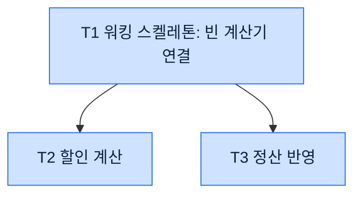

# sdd:task — 설계 다음의 구현 계획 문서

요구사항 문서와 설계 문서를 받아 "어떤 순서로 만드는가" 를 `tasks.md` 로 쓴다. 문서를 연 사람이 무엇을 동시에 돌릴 수 있고 어디까지 왔는지를 그림 하나로 보게 하는 것이 목적이다. 코드는 바꾸지 않는다.

먼저 `${CLAUDE_PLUGIN_ROOT}/references/spec-format.md` 를 읽는다. 「한 번만 쓴다」는 그 문서를 따른다.

- `sdd:draft`: 요구사항 문서(무엇을). 이 스킬의 입력이다
- `sdd:design`: 설계 문서(어떻게). 이 스킬의 입력이다
- `wt:plan`: 워크트리·draft PR 을 만들고, PR 본문 하나만 보고 일할 수 있는 지시서를 쓴다. 이 스킬은 PR 을 만들지 않고, 두 문서를 레퍼런스로 가리킨다

## 입력 찾기

- 포맷 문서 「저장 위치」의 「폴더 고르기」로 폴더를 정한다. 파일 경로를 받으면 그 파일이 있는 폴더다
- 폴더에 `requirements.md` 와 `design.md` 가 **둘 다** 있어야 한다. 하나라도 없으면 쓰지 않고 빠진 문서와 만드는 명령을 알린다
    - `requirements.md` 가 없다 → `/sdd:draft {설명}`
    - `design.md` 가 없다 → `/sdd:design {requirements.md 경로}`
- 두 문서를 끝까지 읽는다. 앞부분만 보고 쓰지 않는다

## 완성 확인

`sdd:design` 「완성」 조건을 그대로 쓴다. 하나라도 어긋나면 tasks.md 를 쓰지 않는다. 결정이 남은 채 계획을 세우면, 결정이 나는 순간 DAG 를 다시 그려야 하기 때문이다.

- 두 문서의 「열린 결정」에 볼드 결정이 0개다. 이탤릭 결정은 남아 있어도 된다
- 두 문서에 `@미정` 이 0개다
- `design.md` 「요구사항 추적」 표가 꽉 차 있다
- 두 문서에 `(작성 중)` 이 없다

어긋나면 채팅에 이렇게 답하고 멈춘다.

- 첫 줄: 다음에 답할 결정 하나와 그 결정이 있는 문서. 요구사항 문서의 결정이 먼저다
- 둘째 줄: 남은 볼드 결정 ID 와 `@미정` 자리 목록
- 셋째 줄: 답한 뒤 실행할 명령 (`/sdd:design {경로}` 로 답 반영 → `/sdd:task {폴더}`)

## 저장 위치

- 입력 폴더의 `tasks.md` (예: `~/.sdd/dotfiles/20261102143005_제휴카페-임직원-할인/tasks.md`). 나머지는 포맷 문서의 「저장 위치」를 따른다
- 이미 있는 `tasks.md` 를 고쳐 쓸 때는 이미 `done` 인 작업과 체크박스를 그대로 둔다
- 마스터가 요청하기 전에는 커밋하지 않는다

## 조사

- `git fetch` 후 `origin/main` 기준으로 읽는다 (`git grep … origin/main`, `git show origin/main:{path}`)
- `design.md` 「컴포넌트 설계」의 컴포넌트마다 바꿀 파일을 직접 확인한다. 확인하지 못한 파일은 "확인하지 않았다" 로 적는다
- 테스트 명령과 테스트 위치를 확인한다. 작업의 「완료 확인」 근거다

## 작업 나누기

- 작업 하나는 커밋 하나다. 커밋 메시지 한 줄로 설명할 수 없으면 나눈다
- 첫 작업은 워킹 스켈레톤이다. 빈 컴포넌트를 연결해 한 경로가 끝까지 도는 것을 먼저 확인한다. 이미 검증된 패턴의 반복이면 생략한다
- `design.md` 「요구사항 추적」의 모든 행이 적어도 한 작업의 「가리키는 곳」에 들어가야 한다. 빠진 행이 있으면 작업을 더한다
- 작업 ID 는 `T1`, `T2` 처럼 붙인다. 고쳐 쓸 때 기존 ID 는 바꾸지 않고, 새 작업은 다음 번호를 쓴다

## 한 번만 쓴다 (세 문서 사이)

- 요구사항·설계 문서의 규칙·수치·인터페이스·용어 정의를 tasks.md 에 옮겨 적지 않는다
- 가리키는 법: `요구사항 {n} 인수 조건 {m}`, `요구사항 {n} 업무 규칙`, `design.md 컴포넌트 {이름}`, `design.md 오류 {ID}`
- tasks.md 에만 있는 것: 작업 순서와 의존, 바꿀 파일, 절차, 완료 확인 명령, 진행 상태
- 계획 중 설계의 빈 곳을 찾으면 tasks.md 에 메우지 않는다. 끝맺음에 `design.md` 에 올릴 결정 문장으로 제안한다

## 문서 구성 (이 순서)

### 제목과 기준

- 제목: `# {기능} 구현 계획`. 기능 이름은 요구사항 문서 제목에서 가져온다
- 기준 줄: `기준: \`requirements.md\`, \`design.md\` (origin/main {짧은 커밋})`

### 작업 DAG

제목과 기준 줄 바로 다음 첫 절이다.

- ```mermaid `flowchart TD` 하나. 노드 하나가 작업 하나다
- 노드 ID 는 작업 ID 와 같다. 라벨은 `T1["T1 워킹 스켈레톤: 빈 계산기 연결"]` 처럼 큰따옴표로 감싼다. 괄호나 콜론이 섞여도 깨지지 않는다
- 화살표는 "이게 끝나야 저걸 시작할 수 있다" 는 의존만 그린다. 순서가 편해서 이은 화살표는 동시에 돌릴 기회를 가린다
- 색은 아래 두 줄로 고정한다. 다른 색·모양(결정 노드 등)은 쓰지 않는다
    - 완료: `classDef done fill:#1f6feb,stroke:#1f6feb,color:#ffffff`
    - 미완료: `classDef todo fill:#cfe2ff,stroke:#1f6feb,color:#0b1f44`
- 모든 노드는 `class … done` 또는 `class … todo` 중 한 줄에만 들어간다. 처음 쓸 때는 모두 `todo` 다
- 노드가 0개인 `class` 줄은 두지 않는다. 빈 `class` 줄은 mermaid 문법 오류다. `classDef` 두 줄은 항상 둔다
- DAG 바로 아래에 「진행 규칙」 인용 블록을 그대로 둔다

### 작업

작업마다 `### T{n} {이름}` 헤딩 하나. DAG 의 위상 순서로 놓는다.

- `- [ ] 완료`
- 선행: 작업 ID 목록. 없으면 "없음"
- 가리키는 곳: 요구사항·설계 번호 (「한 번만 쓴다」)
- 바꿀 파일: 경로 목록. 새 파일은 `(새)` 를 붙인다
- 절차: 2단 불릿. 한 단계에 행동 하나
- 완료 확인: 실행할 명령과 통과 기준. 자동 확인이 없으면 `design.md` 「테스트 전략」의 운영 확인을 가리킨다

## 형식

````markdown
# {기능} 구현 계획

기준: `requirements.md`, `design.md` (origin/main {짧은 커밋})

## 작업 DAG



> 진행 규칙: 작업 하나를 끝내 커밋하면, 그 노드를 `todo` 줄에서 `done` 줄로 옮기고 그 작업의 체크박스를 체크한다. 노드가 0개가 된 `class` 줄은 지운다. 화살표로 이어지지 않은 작업은 동시에 진행해도 된다.

## 작업

### T1 워킹 스켈레톤: 빈 계산기 연결

- [ ] 완료
- 선행: 없음
- 가리키는 곳: design.md 컴포넌트 `PartnerDiscountCalculator`, `OrderController`
- 바꿀 파일: `src/discount/partner.ts` (새), `src/order/controller.ts`
- 절차
    - 0원을 돌려주는 `calc` 를 만든다
    - 주문 저장 경로에서 `calc` 를 부른다
- 완료 확인: `npm test -- order.spec.ts` 통과

### T2 할인 계산

- [ ] 완료
- 선행: T1
- 가리키는 곳: 요구사항 2 인수 조건 1~3, 요구사항 2 업무 규칙
- 바꿀 파일: `src/discount/partner.ts`
- 절차
    - 업무 규칙 표의 경계 행으로 실패하는 테스트를 먼저 쓴다
    - 계산 함수를 채운다
- 완료 확인: `npm test -- partner.spec.ts` 통과
````

## 진행 규칙

DAG 아래 인용 블록이 이 규칙이다. tasks.md 를 보고 일하는 세션이 따른다.

- 작업 하나를 끝내 커밋하면 그 노드 ID 를 `class … todo` 줄에서 빼고 `class … done` 줄에 넣는다
- 같은 때 그 작업의 `- [ ] 완료` 를 `- [x] 완료` 로 바꾼다
- 노드가 0개가 된 `class` 줄은 지운다. `done` 줄이 없으면 새로 만든다

## 끝맺음

- 첫 줄: 지금 바로 시작할 수 있는 작업(선행이 없는 작업) ID 목록
- 둘째 줄: 문서 경로(클릭 가능한 `path`)
- 무엇을 썼는지 불릿 5개 이하. 작업 수와 「요구사항 추적」 행 커버 수(예: 18/18)를 포함한다
- 설계의 빈 곳을 찾았으면 `design.md` 에 올릴 결정 문장을 한 줄씩, 3개 이하

## 하지 않는 것

- 코드를 바꾸지 않는다
- 워크트리·브랜치·PR 을 만들지 않는다. 필요하면 `wt:init` 을 쓴다
- 요구사항·설계 문서를 고치지 않는다
- 요구사항·설계 문서의 규칙·수치를 tasks.md 에 옮겨 적지 않는다
- 「완성 확인」에 어긋난 채로 tasks.md 를 쓰지 않는다
